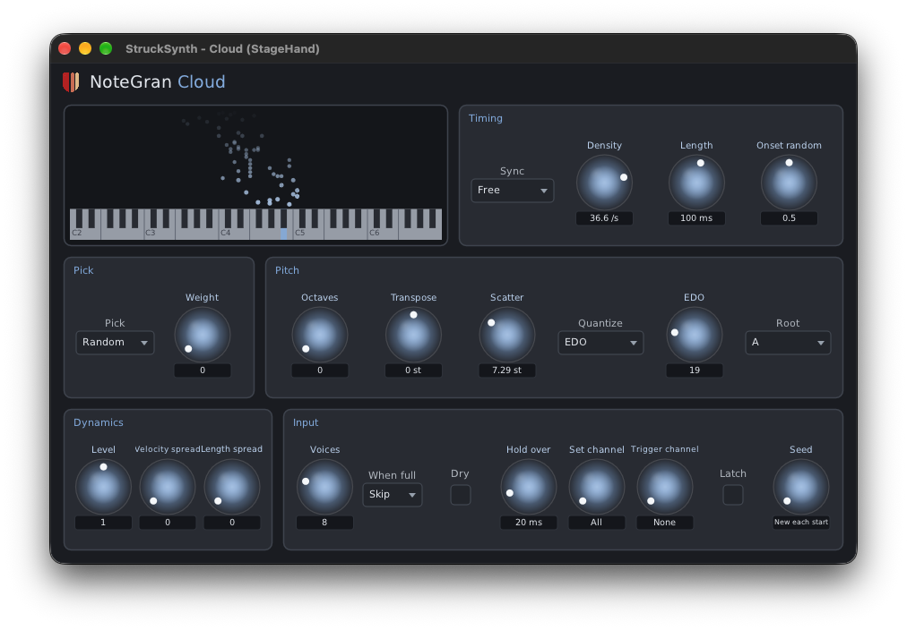

# NoteGran

Granular synthesis with notes as the grains. NoteGran is a set of MIDI note effects from
Unlikelyware that make new notes from the notes they hear. Hold a chord and NoteGran Cloud
scatters grains picked from it. Play a phrase and NoteGran Buffer replays fragments of it. The
synth after it makes the sound; NoteGran makes no audio.



| | |
|---|---|
| Effects | Cloud, Chords, Grid, Burst and Buffer, in one `.clap` |
| Formats | CLAP |
| Platforms | Linux x86-64, macOS 26 or later on Apple Silicon. No Windows |
| Version | 0.9.0 (preview) |
| License | MIT |

**Downloads:** ready-built plugins will be in the
[Unlikelyware downloads](https://github.com/erickampman/unlikelyware) with the 0.9 preview. This repo
has the source only.

## The five effects

| Effect | What it does |
|---|---|
| **Cloud** | A scatter of grains whose pitches are picked from the notes held: at random, up, down or as played. Evenly spaced on the beat it's an arpeggiator; with more randomness it thins out into a cloud |
| **Chords** | Turns each note into a chord in a scale. Familiar scales (the modes of major, melodic and harmonic minor, the pentatonics and more) are mapped into any EDO, or the scale comes from notes held on a channel |
| **Grid** | Grains on a beat grid with tiers (downbeat, beat, off-beat and so on), each with its own probability, level, pick and offset. Straight or grouped meters (5, 7, 9) |
| **Burst** | Each new note starts a phrase of grains shaped by a two-transform fractal (IFS) attractor, drawn and edited in its window |
| **Buffer** | Captures the notes played in the last few seconds or beats and reads grains from that capture, a note at a time or a fragment at a time, with Position, Scan, Spray and Freeze |

Each has its own editor with a live view of the notes held and the grains they make. The **?** at
the top right of each opens that effect's help page (built from [resources/help.md](resources/help.md))
in your browser.

## What makes it different

- **The notes held are the input.** Anything that holds notes can drive it: a keyboard,
  [KeyboardEDO](https://github.com/erickampman/KeyboardEDO), a sequencer or looper, or a host
  clip. Chords can feed Cloud, Grid or Burst.
- **Microtonal throughout.** Pitches are worked in 1/512 semitone and sent as MIDI 2.0 Pitch 7.9,
  so EDO pitches from KeyboardEDO survive, and Quantize can snap to any EDO from 1 to 96 or to the
  notes held. In hosts that send CLAP notes, the fraction goes as a tuning expression.
- **Repeatable.** With a seed set, the same input at the same times gives the same notes on any
  machine, whatever the block size.
- **Made for real synths.** Every grain is a voice on the synth after it, so each effect has a
  Voices limit (default 8) and a choice of skipping or stealing when it's full. Every note it
  starts, it ends.

## Which hosts keep the fraction

| Host | Microtonal output |
|---|---|
| [StageHand](https://github.com/erickampman/StageHand) | Yes (MIDI 2.0) |
| Bitwig | Yes (CLAP notes with tuning expressions) |
| REAPER | No: plays the output as 12-EDO |

## Installing

The download holds `NoteGran.clap`. Put it in your CLAP folder (create the folder if it isn't there),
then rescan plugins in your host:

| | Linux | macOS |
|---|---|---|
| For you | `~/.clap` | `~/Library/Audio/Plug-Ins/CLAP` |
| For every user | `/usr/lib/clap` | `/Library/Audio/Plug-Ins/CLAP` |

On macOS, `~/Library` is hidden in Finder: Go ▸ Go to Folder opens it.

A host that is already running keeps the plugins it loaded: quit and restart it. What each platform
needs, and more on rescanning, is in the downloads repo's [install
notes](https://github.com/erickampman/unlikelyware#installing). To build NoteGran yourself instead,
see below.

## Building from source

```bash
git clone https://github.com/erickampman/NoteGran.git
cd NoteGran
tools/fetch_deps.sh
cmake -B build -G Ninja -DCMAKE_BUILD_TYPE=Release
cmake --build build
```

[BUILDING.md](BUILDING.md) has the prerequisites for Linux and macOS.
[docs/design.md](docs/design.md) explains how it works: the set, the clock, the voice limit and
each effect in detail.

## Help and bugs

Questions and bug reports go to [GitHub Issues](https://github.com/erickampman/NoteGran/issues).

## License

MIT. See [LICENSE](LICENSE).

## Trademarks

VST® is a registered trademark of Steinberg Media Technologies GmbH. Audio Units, Logic, Mac and
macOS are trademarks of Apple Inc., registered in the U.S. and other countries. Linux is the
registered trademark of Linus Torvalds in the U.S. and other countries. Other product names are
trademarks of their owners, named here only to say what works with what.
